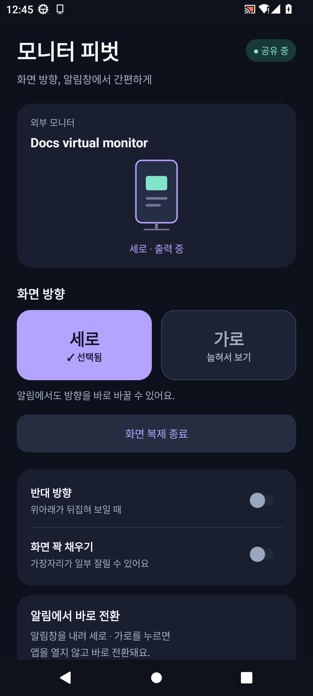
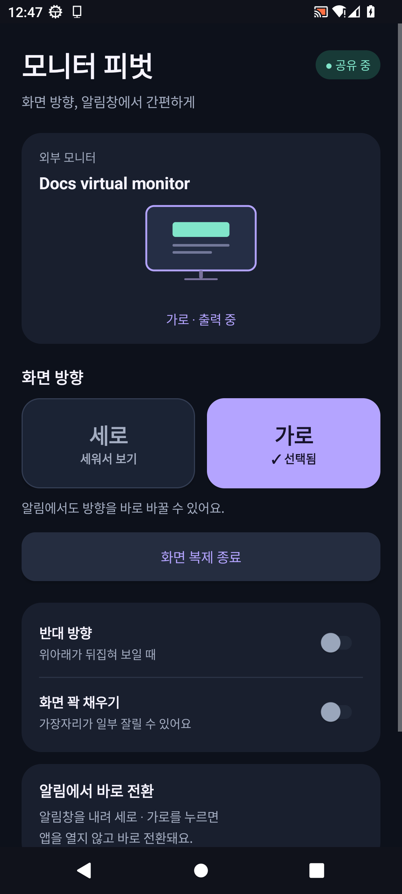
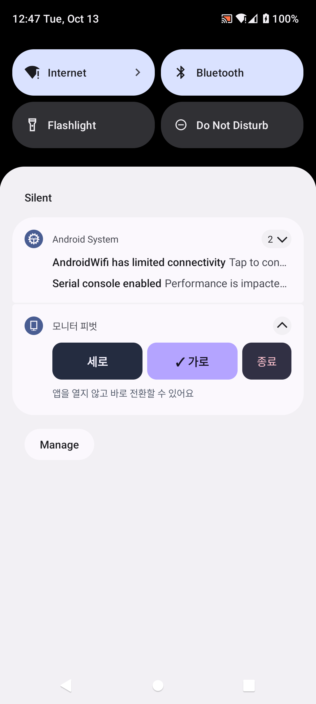

# Galaxy Monitor Pivot

갤럭시에 연결한 외부 모니터를 **세로·가로로 전환**하는 Android 앱입니다. DeX 없이 화면을 복제하고, 복제 중에는 **알림창에서 앱을 열지 않고 바로 방향을 바꿀 수 있습니다.**

**[APK v1.2.0 다운로드](https://github.com/glasscola/galaxy-monitor-pivot/releases/download/v1.2.0/PivotControl-1.2.0.apk)** · **[설치 및 사용 설명서](docs/USER_GUIDE.md)** · **[릴리스](https://github.com/glasscola/galaxy-monitor-pivot/releases)**

## 주요 기능

- 세로 / 가로 / 반대 방향 회전
- 작은 알림과 펼친 알림에서 바로 방향 전환 및 종료
- 앱과 알림에서 선택한 방향을 보라색과 체크 표시로 구분
- 화면 전체 보기 또는 가장자리를 잘라 꽉 채우기
- 복제를 종료하면 기본 미러링으로 복귀
- 화면을 저장하거나 인터넷으로 전송하지 않는 로컬 처리

## 화면

아래 이미지는 **배포 APK를 Android 13 에뮬레이터에서 실행해 캡처한 화면**입니다. 갤럭시 실기기나 제우스랩 모니터 촬영 사진이 아닙니다.

| 세로 선택 | 가로 선택 |
| --- | --- |
|  |  |

| 알림창 직접 전환 |
| --- |
|  |

화면별 설명과 외부 출력 예시는 [화면 안내](docs/SCREENSHOTS.md)를 참고하세요.

## 빠른 시작

1. [릴리스](https://github.com/glasscola/galaxy-monitor-pivot/releases/tag/v1.2.0)에서 `PivotControl-1.2.0.apk`를 내려받아 설치합니다.
2. 영상 출력 지원 USB-C 케이블 또는 USB-C → HDMI 어댑터로 모니터를 연결합니다.
3. 모니터 본체를 원하는 방향으로 돌린 뒤 앱에서 **세로** 또는 **가로**를 선택합니다.
4. Android 화면 공유 확인 창에서 **시작**을 허용합니다.
5. 휴대폰에서 유튜브 등 원하는 앱을 엽니다. 이후 방향은 **알림창의 세로 / 가로 버튼**으로 바꿉니다.

기존 1.0 / 1.1 버전 사용자는 같은 서명으로 만들어진 이 APK를 **업데이트 설치**할 수 있습니다. 화면 공유를 새로 시작할 때는 Android 승인이 필요합니다.

## 지원 및 제한

- **Android 11 이상**과 영상 출력이 가능한 휴대폰·케이블·모니터가 필요합니다.
- 기본 화면 복제 모드는 **DeX, 루팅, Shizuku 없이** 사용합니다. 별도의 고급 시스템 회전 모드는 Shizuku가 필요합니다.
- 갤럭시 S20 사용 환경을 바탕으로 만들었습니다. 1.1의 회전 기능은 사용자가 기기에서 동작을 확인했으며, 모든 갤럭시·모니터 조합의 호환성을 보장하지 않습니다.
- 알림을 표시하려면 앱 알림과 ‘외부 화면 복제’ 알림을 허용해야 합니다.
- 화면 꽉 채우기는 비율을 유지하며 가장자리를 자릅니다. 앱 자체의 화면 비율이나 휴대폰 회전 잠금을 변경하지 않습니다.
- DRM 영상과 보안 화면은 검게 보일 수 있습니다. 소리는 휴대폰의 기존 출력 경로를 사용합니다.
- 캡처를 다시 표시하므로 추가 지연과 배터리 소모가 생길 수 있습니다.

## 개발

Android Studio에서 프로젝트를 열거나, Windows PowerShell 7+와 JDK 17, Android SDK 36 / Build Tools 36.0.0으로 빌드할 수 있습니다.

```powershell
.\build-apk.ps1 -SdkPath 'C:\path\to\Android\Sdk'
.\test-host.ps1
```

로컬 빌드는 테스트 키를 생성합니다. **다른 키로 다시 빌드한 APK는 배포 APK 위에 업데이트 설치할 수 없습니다.** 자신의 배포 키를 사용할 때는 `-KeyStorePath`, `-KeyAlias`와 환경변수 `PIVOT_STORE_PASSWORD`를 지정하세요. 서명 키는 저장소에 포함하지 않습니다.

자세한 구조와 검증 범위는 [개발 및 검증 안내](docs/DEVELOPMENT.md)에 정리했습니다.

## 라이선스

자체 소스는 [MIT](LICENSE.txt)입니다. 동봉한 Shizuku API는 [MIT](SHIZUKU-LICENSE.txt), AndroidX annotation은 [Apache 2.0](ANDROIDX-LICENSE.txt)입니다.
