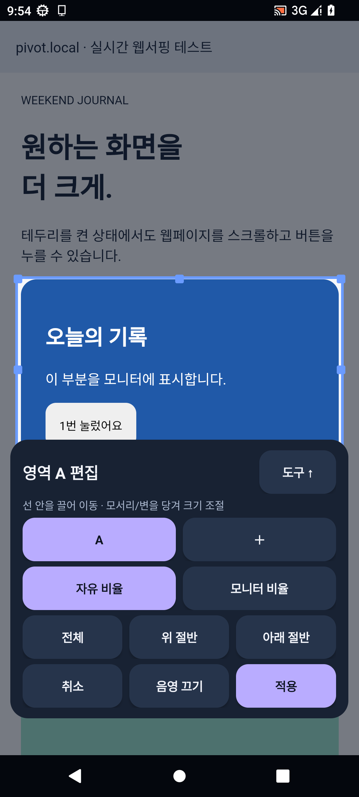
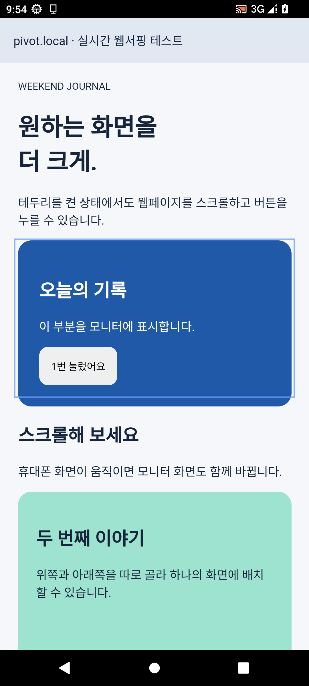
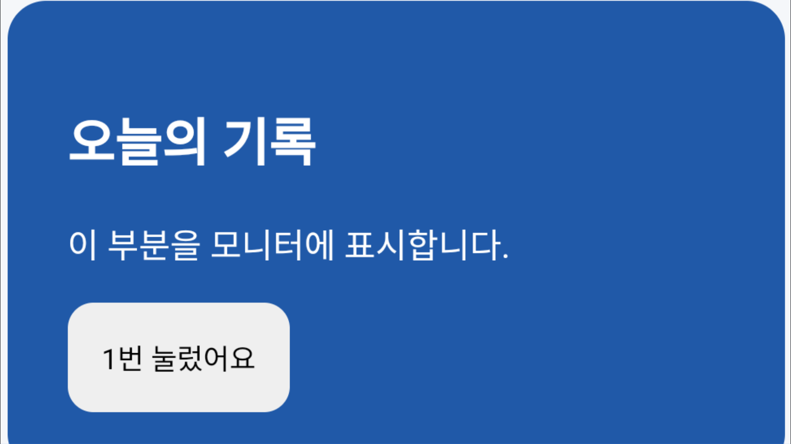
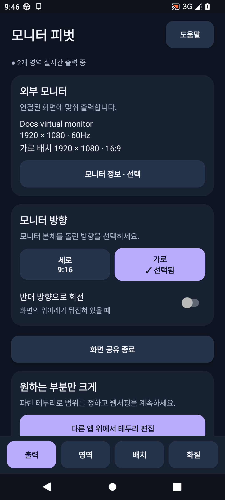
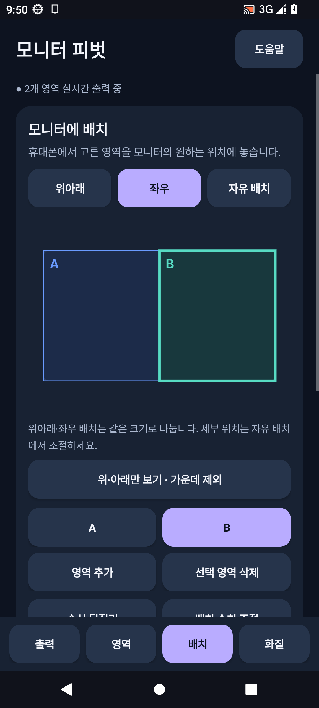
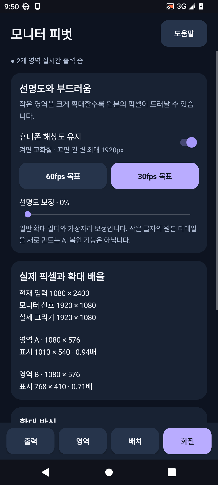

# Galaxy Monitor Pivot 2.0

갤럭시에 연결한 외부 모니터에 **휴대폰 화면의 원하는 부분만 실시간으로 표시하는 Android 앱**입니다. 세로·가로 피벗과 함께, 화면 위의 테두리로 영역을 고르고 여러 부분을 한 모니터에 배치할 수 있습니다.

**[APK v2.0.0 다운로드](https://github.com/glasscola/galaxy-monitor-pivot/releases/download/v2.0.0/PivotControl-2.0.0.apk)** · **[설치 및 사용 설명서](docs/USER_GUIDE.md)** · **[업데이트 내역](CHANGELOG.md)**

## 테두리를 켠 채 웹서핑

1. 휴대폰과 모니터를 연결하고 앱에서 **화면 공유 시작**을 누릅니다.
2. 브라우저를 열고, 펼친 알림에서 **테두리 편집**을 누릅니다.
3. 사각형을 끌거나 손잡이를 당겨 출력할 범위를 정하고 **적용**합니다.
4. 파란 선만 남은 상태로 웹페이지를 스크롤하거나 링크를 누릅니다. 모니터에는 그 안쪽 내용이 실시간으로 표시됩니다.

테두리는 휴대폰 화면의 위치에 고정됩니다. 스크롤한 사진이나 웹페이지 요소를 자동으로 따라가지는 않습니다. 화면을 사진 파일로 저장하지 않습니다.

| 실제 앱에서 영역 편집 | 적용 후 테두리만 표시 |
| --- | --- |
|  |  |

아래는 선택 영역을 표시한 **1920 × 1080 가상 외부 모니터의 실제 출력**입니다.

모든 화면은 Android 13 에뮬레이터에서 실제 APK로 촬영했습니다. 웹페이지는 별도 테스트 앱의 로컬 WebView이며, 갤럭시 S20이나 제우스랩 실물 촬영 사진이 아닙니다.

## 주요 기능

- **피벗:** 세로·가로·반대 방향, 알림에서 즉시 전환.
- **모니터 정보:** 현재 해상도, 주사율, 화면 비율, 기기가 보고한 지원 모드.
- **영역 지정:** 최대 4개, 자유 비율 또는 모니터 비율, 드래그·손잡이·백분율 입력.
- **빠른 구성:** 전체, 위 절반, 아래 절반, 가운데를 제외한 위·아래 두 영역.
- **실시간 오버레이:** 편집 중 음영 켜기/끄기, 도구 위치 위/아래 이동, 적용 후 선만 표시.
- **모니터 배치:** 위아래·좌우·자유 배치, 영역 순서 뒤집기, 위치·크기 조절.
- **화면 맞춤:** 비율 유지 전체 보기, 꽉 채우기, 1:1 픽셀 표시.
- **화질:** 휴대폰 해상도 유지 또는 성능 모드, 30/60fps 목표, 약한 선명도 보정.
- **확대 정보:** 실제 입력·그리기 크기, 영역별 픽셀과 확대 배율.
- **저장:** 영역·배치·방향·화질을 이름을 붙여 저장하고 불러오기.
- **일시정지:** 마지막 모니터 화면을 유지했다가 최신 화면으로 재개.

| 출력 | 배치 | 화질 |
| --- | --- | --- |
|  |  |  |

## 설치와 지원

Android 11 이상이며, 휴대폰과 연결 장치가 외부 영상 출력을 지원해야 합니다. 기본 모드는 **DeX·루팅·Shizuku 없이** 사용합니다. 다른 앱 위의 테두리에는 **다른 앱 위에 표시** 권한, 알림 조작에는 알림 허용이 필요합니다.

기존 배포 APK와 같은 서명으로 제작해 업데이트 설치할 수 있습니다. APK만 설치하면 되며 GitHub의 소스 코드 ZIP은 설치 파일이 아닙니다.

## 알아둘 점

- 편집 중에는 모니터의 마지막 프레임을 유지하고, 적용 후 실시간 출력으로 돌아갑니다.
- 모니터의 실제 인치 크기나 물리적으로 세워 둔 방향을 자동 감지하지 않습니다.
- 화면에 현재 보이는 부분을 가져옵니다. 화면 밖의 페이지나 숨겨진 다른 앱을 별도로 실행하지 않습니다.
- 확대 필터는 원본에 없는 글자 디테일을 복원하지 않습니다. AI 초해상도 기능은 포함하지 않습니다.
- 보호된 영상과 보안 화면은 검게 보일 수 있습니다. 다른 앱이 오버레이를 차단할 수 있습니다.
- 선택 영역 안의 알림이나 키보드도 표시될 수 있습니다. 소리는 휴대폰의 기존 출력 경로를 사용합니다.
- 안내선은 선택 영역 바깥쪽에 그립니다. 화면 끝이나 다른 영역과 겹치는 선 일부는 보이지 않을 수 있습니다.
- S20 USB-C 실기기에서 이번 2.0 버전의 성능·발열·오버레이 호환성은 추가 확인이 필요합니다.

## 개발

Windows PowerShell 7+, JDK 17, Android SDK 36 / Build Tools 36.0.0:

~~~powershell
.\build-apk.ps1 -SdkPath 'C:\path\to\Android\Sdk'
.\test-host.ps1
~~~

[구조와 검증 결과](docs/DEVELOPMENT.md) · [화면별 안내](docs/SCREENSHOTS.md)

자체 소스는 [MIT](LICENSE.txt)입니다. Shizuku API와 AndroidX의 라이선스는 저장소의 별도 파일을 참고하세요.
