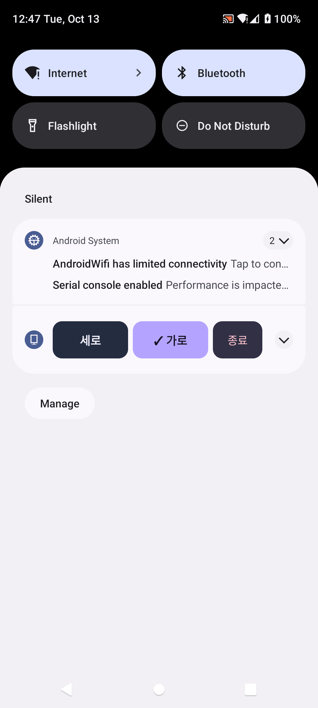
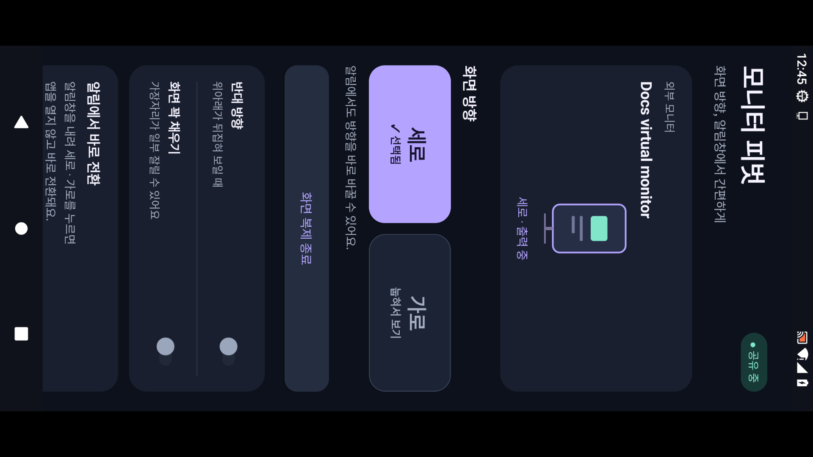

# 화면 안내

모든 이미지는 **공개 APK v1.2.0을 Android 13 에뮬레이터에서 실행한 캡처**입니다. 외부 화면은 테스트용 가상 모니터를 사용했습니다. 실제 갤럭시·모니터를 촬영한 사진이 아닙니다.

## 세로 선택

세로 버튼이 보라색과 체크 표시로 강조됩니다. 모니터 미리보기와 출력 방향도 함께 바뀝니다.

## 가로 선택

가로 버튼이 강조되고, 세로 버튼은 선택되지 않은 상태로 표시됩니다.

## 알림창 직접 전환

세로 / 가로 / 종료 버튼이 있는 알림입니다. 방향 버튼은 앱을 열지 않고 복제 서비스에 명령을 전달합니다. 갤럭시 One UI의 알림 장식과 배치는 에뮬레이터의 기본 Android 알림과 다를 수 있습니다.

### 작은 알림

알림을 작게 접어도 세로·가로·종료 버튼이 표시됩니다. 화면에 보이는 Android System 메시지는 에뮬레이터가 생성한 별도 시스템 알림입니다.

## 외부 출력 예시

휴대폰 화면을 회전해 1920 × 1080 가상 모니터에 출력한 캡처입니다. **모니터 본체를 세워서 볼 수 있도록 출력 신호 안에서 화면을 회전한 상태**이므로, 이 가로 이미지 파일에서는 내용이 옆으로 보입니다. 모니터를 직접 돌려 사용하는 기능입니다.

원본 이미지 파일은 `docs/images/`에 있습니다.
