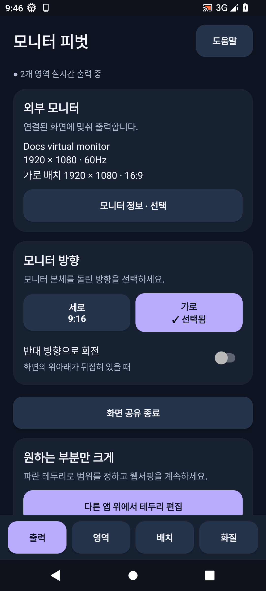
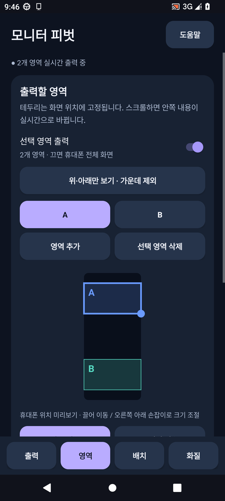
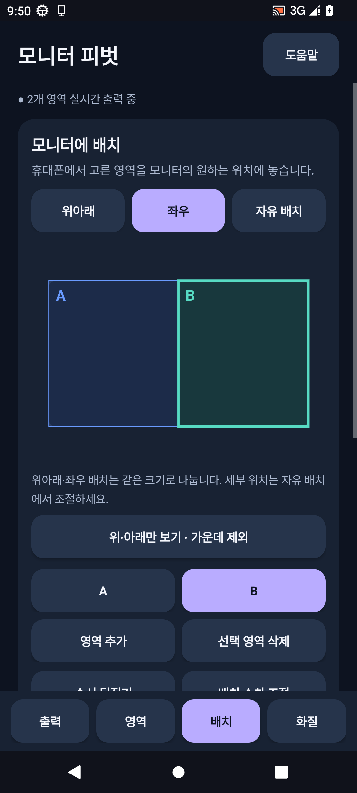
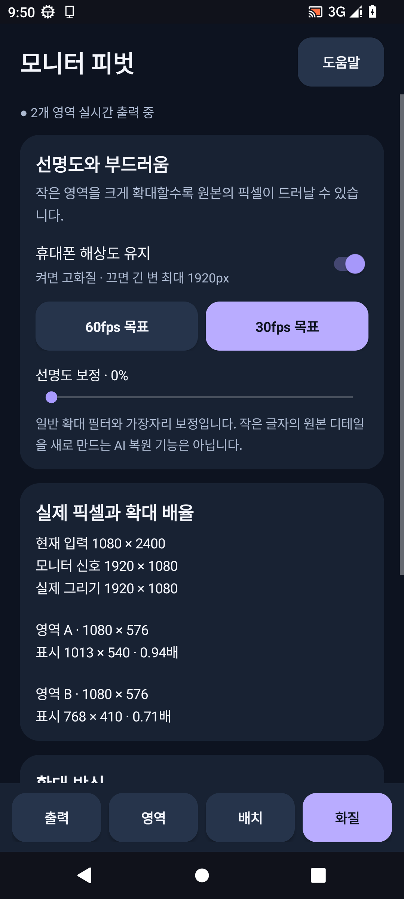
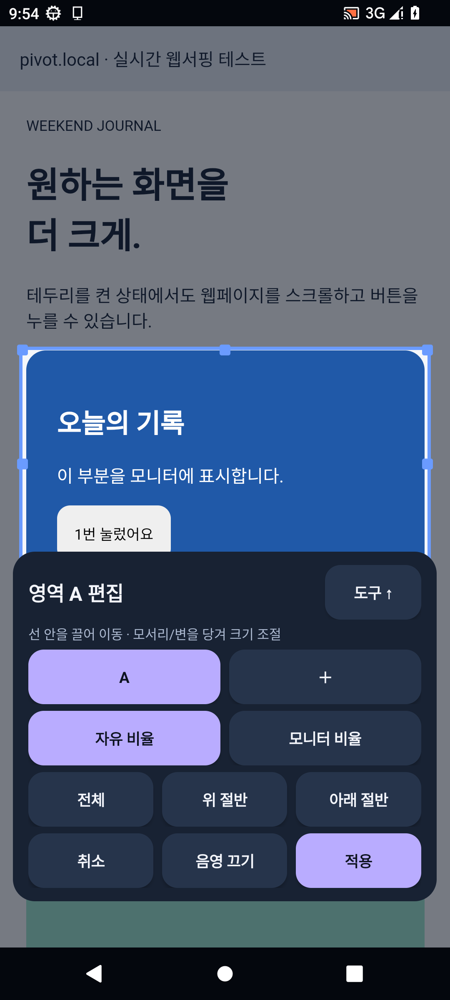
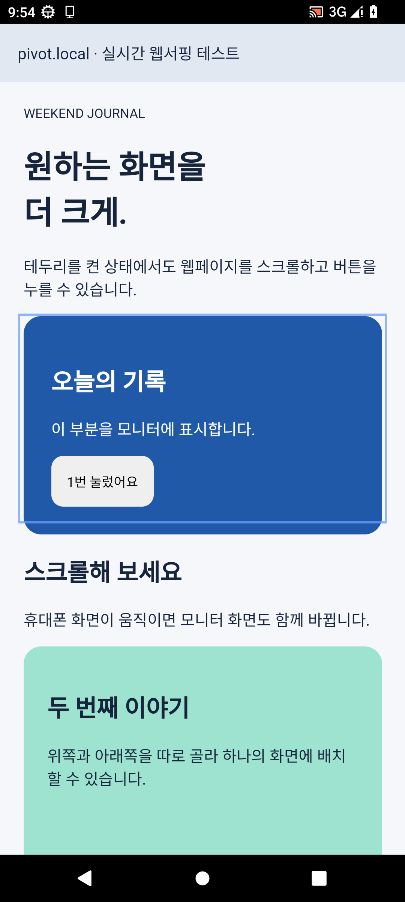
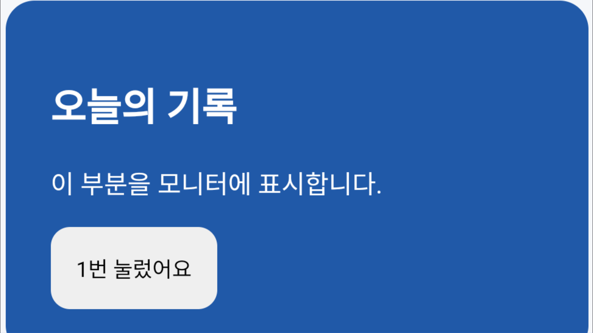
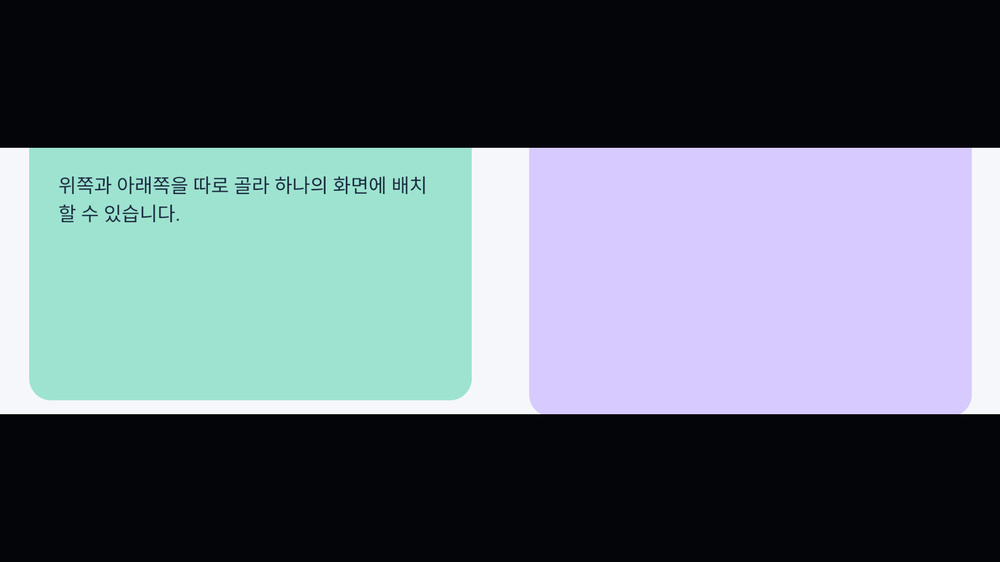
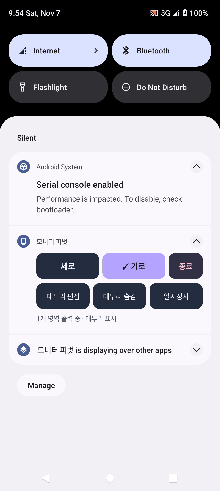

# 2.0 실행 화면

Android 13 에뮬레이터에서 배포 APK를 실행한 화면입니다. 외부 출력은 1920 × 1080 가상 디스플레이에서 읽었습니다. 웹페이지는 별도 테스트 앱의 로컬 WebView입니다. 실물 휴대폰·모니터 사진이나 AI로 생성한 UI 시안이 아닙니다.

| 출력 | 영역 |
| --- | --- |
|  |  |

| 배치 | 화질 |
| --- | --- |
|  |  |

| 편집 중 | 적용 후 웹서핑 |
| --- | --- |
|  |  |

이전 버전의 캡처는 images 폴더에 보관되어 있습니다. 현재 버전 화면은 images/v2를 사용합니다.
