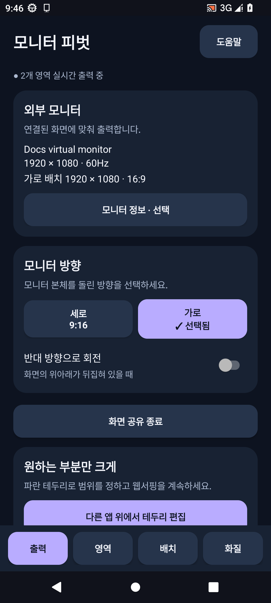
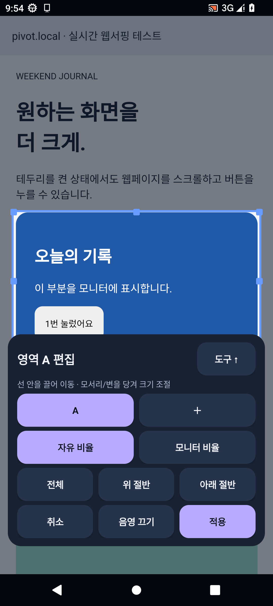
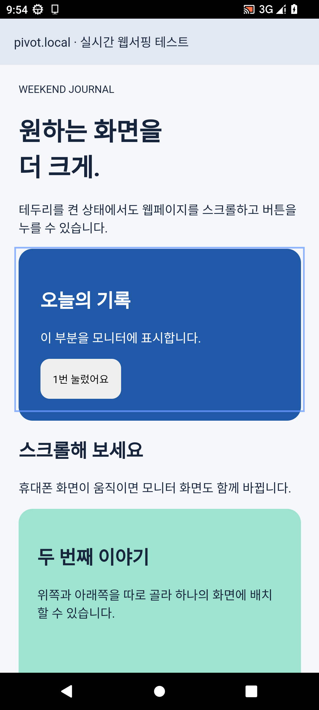
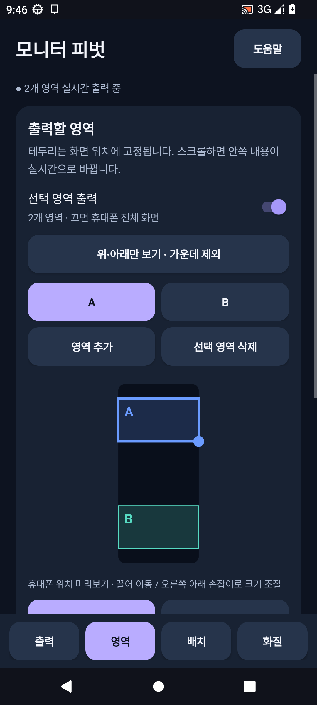
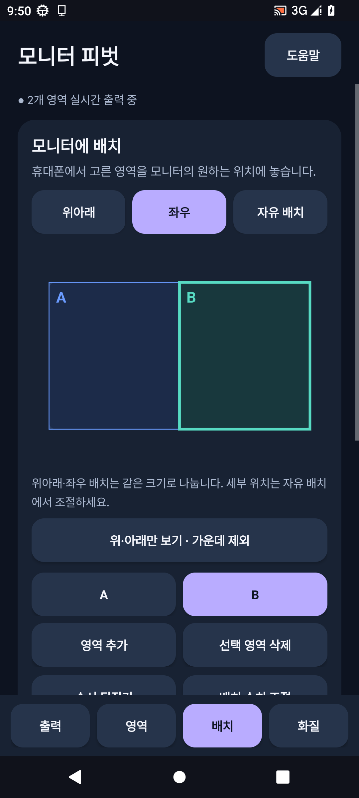
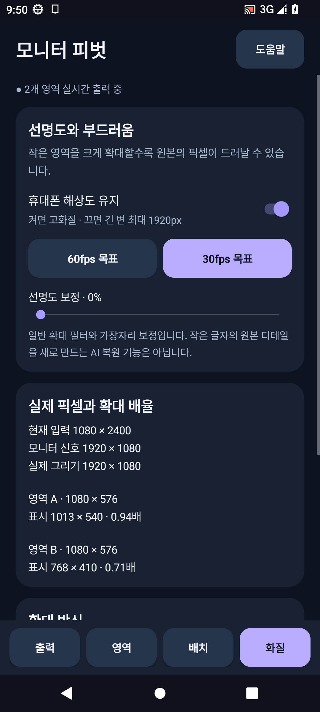
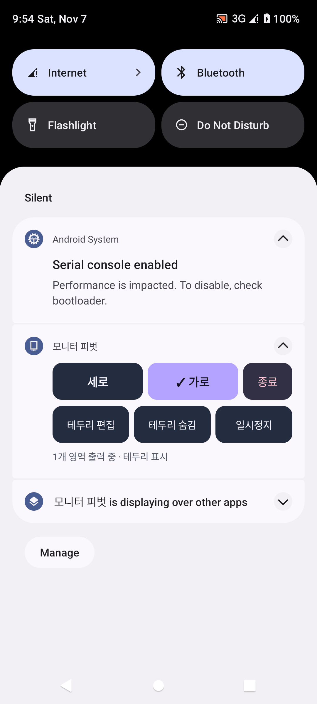

# 모니터 피벗 2.0 사용 설명서

## 설치와 첫 연결

[APK 다운로드](https://github.com/glasscola/galaxy-monitor-pivot/releases/download/v2.0.0/PivotControl-2.0.0.apk)에서 파일을 받은 뒤 실행해 설치합니다. 이전 배포 버전 위에 업데이트할 수 있습니다.

영상 출력 지원 USB-C 케이블 또는 USB-C → HDMI 어댑터로 모니터를 연결하세요. 앱의 **출력** 탭에 모니터 이름과 해상도가 나타나면 모니터를 돌린 방향에 맞춰 **세로 / 가로**를 선택합니다. 실제 모니터는 직접 돌려야 합니다.

**화면 공유 시작**을 누르고 Android 확인 창에서 허용하세요. 전체 화면 공유를 사용하므로 휴대폰에서 앱을 바꾸어도 출력이 이어집니다. 알림과 개인 정보도 선택 영역 안에 들어오면 표시될 수 있습니다.

## 원하는 부분만 실시간 출력

1. 브라우저나 원하는 앱을 엽니다.
2. 알림창을 내려 **모니터 피벗 알림을 펼칩니다.**
3. **테두리 편집**을 누릅니다. 처음에는 ‘다른 앱 위에 표시’ 권한을 허용해야 합니다. 권한을 허용한 후 원하는 앱으로 돌아가 다시 편집을 누르세요.
4. 사각형 안을 끌어 이동합니다. 모서리와 변의 손잡이를 당겨 크기를 바꿉니다.
5. 자유롭게 조절하려면 **자유 비율**, 모니터 방향에 맞추려면 **모니터 비율**을 선택합니다. 비율 설정은 모든 영역에 적용됩니다.
6. **적용**하면 파란 선만 남고, 스크롤과 터치가 원래 앱으로 전달됩니다.

편집 중에는 모니터의 마지막 화면을 유지합니다. **취소**하면 이전에 적용한 영역을 유지합니다. 도구가 선택 영역을 가리면 **도구 ↑ / 도구 ↓**로 위치를 옮기세요. **음영 끄기**로 바깥 영역을 정상 밝기로 볼 수 있습니다.

**테두리 숨김**은 선만 숨깁니다. 출력은 계속됩니다. 다시 위치를 바꾸려면 알림의 **테두리 편집**을 누르세요. 앱의 설정 화면을 보는 동안에는 안내선을 잠시 숨겨 설정 읽기를 방해하지 않습니다.

테두리는 화면 좌표에 고정됩니다. 웹페이지를 스크롤하면 그 안의 내용이 바뀝니다. 특정 이미지 자동 추적 기능은 아닙니다.

## 앱 안에서 영역 조절

**영역** 탭의 휴대폰 모양은 위치를 편집하는 도식입니다. 실제 다른 앱의 영상을 보여주는 창은 아닙니다. 실제 내용을 보며 맞추려면 알림에서 오버레이 편집을 사용하세요.

- **선택 영역 출력:** 끄면 전체 화면을 출력합니다.
- **영역 추가 / 삭제:** 최대 4개까지 설정합니다.
- **전체 / 위 절반 / 아래 절반:** 선택한 영역의 범위를 빠르게 바꿉니다.
- **위·아래만 보기:** 화면 위 8~32%, 아래 68~92%를 선택해 가운데를 제외합니다.
- **위치·크기 숫자로 조절:** 왼쪽·위 위치와 너비·높이를 백분율로 입력합니다.
- 앱 내부 미리보기에서는 사각형을 끌어 이동하고 오른쪽 아래 손잡이로 크기를 바꿉니다.

## 여러 영역을 모니터에 배치

**배치** 탭은 모니터의 출력 위치를 정하는 화면입니다.

- **위아래 / 좌우:** 영역을 같은 크기의 칸에 나눠 배치합니다.
- **자유 배치:** 사각형을 끌어 위치를 바꾸고 오른쪽 아래 손잡이로 크기를 조절합니다.
- **배치 수치 조절:** 위치와 크기를 정확한 비율로 입력합니다. 적용하면 자유 배치로 전환합니다.
- **순서 뒤집기:** 영역 순서를 뒤집습니다. 자유 배치에서 겹친 부분은 뒤쪽 알파벳의 영역이 위에 표시됩니다.

예를 들어 휴대폰 위쪽 A와 아래쪽 B만 골라 모니터에 나란히 배치할 수 있습니다. 화면 밖으로 스크롤된 내용을 유지하거나 서로 다른 앱을 독립 실행하는 기능은 아닙니다.

## 화질과 확대

**휴대폰 해상도 유지**를 켜면 현재 휴대폰 해상도에 맞춰 입력받습니다. 끄면 긴 변을 최대 1920픽셀로 줄여 처리 부담을 낮춥니다. **60fps 목표 / 30fps 목표**는 처리 목표이며, 실제 프레임 속도는 기기·앱·연결 상태에 따라 달라집니다.

- **전체 보이기:** 비율을 유지하며 전체 영역을 표시합니다. 여백이 생길 수 있습니다.
- **꽉 채우기:** 비율을 유지하며 칸을 채웁니다. 가장자리가 잘릴 수 있습니다.
- **1:1 픽셀:** 입력 한 픽셀을 출력 한 픽셀로 표시합니다. 영역이 칸보다 크면 가운데를 기준으로 잘립니다.
- **선명도 보정:** 약한 가장자리 보정입니다. AI로 작은 글자를 복원하는 기능이 아닙니다.

화질 탭은 실제 입력 크기, 모니터 신호, 앱이 그리는 크기, 영역별 픽셀과 확대 배율을 구분해 표시합니다. 공유 전의 수치는 예상값입니다. 작은 영역을 크게 출력하면 흐려질 수 있습니다.

## 알림, 저장, 방향 변경

펼친 알림에서 **세로 / 가로 / 종료 / 테두리 편집 / 테두리 표시·숨김 / 일시정지·재개**를 사용할 수 있습니다. 접힌 알림은 세로·가로·종료만 표시합니다.

출력 또는 배치 탭 아래에서 설정에 이름을 붙여 저장할 수 있습니다. 저장 범위는 영역, 배치, 모니터 방향, 비율, 화질입니다. 이름이 같으면 덮어쓰기 여부를 확인합니다. 불러오기 목록에서 설정을 선택하면 불러오거나 삭제할 수 있습니다.

휴대폰 자체 방향이 바뀌면 현재 세션에서 기록한 방향별 영역을 불러옵니다. 기록이 없으면 출력을 일시정지하고 다시 영역을 지정하도록 안내합니다. 모니터 연결 해제 시 공유는 종료되며 설정은 남습니다. 새 공유 세션은 Android 승인이 필요합니다.

## 문제 해결

- 모니터가 안 보임: 케이블과 휴대폰이 영상 출력을 지원하는지 확인하세요. 충전 전용 케이블로는 동작하지 않습니다.
- 테두리가 안 보임: 도움말 → 테두리 표시 권한에서 허용 여부를 확인하세요. 보안 앱은 오버레이를 차단할 수 있습니다.
- 알림에 편집 버튼이 없음: 알림을 펼치세요. 알림 자체가 없으면 도움말 → 알림 설정에서 켜세요.
- 화면이 거꾸로임: 출력 탭 → 반대 방향으로 회전을 사용하세요.
- 확대하면 흐림: 휴대폰 해상도 유지, 더 넓은 원본 영역, 브라우저 글자 크기 조절, 작은 출력 배치를 검토하세요.
- 끊김이나 발열: 30fps 목표나 성능 모드로 낮춰 비교하세요.
- 검은 영상: DRM·보안 화면은 화면 공유가 제한될 수 있습니다.

화면은 파일로 저장하거나 서버로 전송하지 않습니다. 이 안내의 실행 화면은 Android 13 에뮬레이터와 로컬 테스트 웹페이지에서 촬영했습니다.
